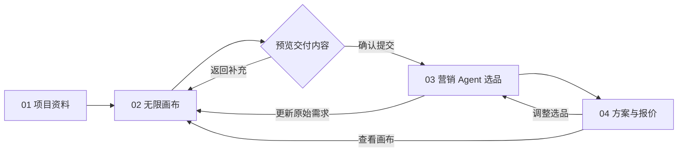

# RSDP 办公全案智能体 · 前端原型设计文档 V0.1

> 版本：V0.1 · 日期：2026-10-09 · 性质：前端交互验证稿（非后端开发设计定稿）  
> 项目仓库：https://github.com/Chen-Minghuan/rsdp  
> 原型 文件：`RSDP_办公智能体_交互原型.html`（浏览器直接打开）

## 1. 一句话定位与决策

**办公是 RSDP 全案选品智能体的业务场景，不新建一套独立 Agent。** 本期先验证「项目资料 → **前置无限画布** → 营销 Agent 智能选品 → 方案报价」的四步交互。

**无限画布用于选品前的空间表达与需求采集**：用户可以放图纸、圈区域、贴便签、标人数、加参考图，将画布结构与原始资料提交给 Marketing Agent；不是先选商品再把商品拖进图纸的布置器。办公商品选品和真实价格以后仍由现有 RSDP 领域服务提供。

### 设计原则

1. **用户界面简单**：主流程只有四页，系统内部可以有解析、需求归一、来源追踪等隐藏步骤。
2. **图纸可选**：允许空白画布起步；PDF/PNG 常用，DWG/DXF 保留辅助入口。
3. **画布是有结构的数据**：对象、坐标、文字、来源、区域关联分别保存，不能仅截图丢给模型。
4. **不确定信息不能变成事实**：用户标注与 AI 推断分开；尺寸、面积不可靠时不能做精确布置承诺。
5. **与 RSDP 解耦接入**：原型不改数据库、不调用生产服务，后续对接现有图纸、Agent、商品和报价接口。
6. **先跑通客户使用体验**：先不做完整 CAD 编辑器、工程级精确排布、3D 渲染、多端多人实时协同。

## 2. 信息架构 / 页面流转



用户首次进入项目时依次看到四步导航；退出后再次打开项目可恢复前次本地草稿（正式实现须以服务端为准）。

### 页面 01：项目资料

**目标**：尽快进入画布，不以完整填表为前置门槛。

- 顶部：项目名称、当前阶段、草稿状态、用户入口。
- 主区左：项目名称、办公人数、预算、风格偏好等轻量字段（均可后续调整）。
- 主区右：资料上传区（PDF、PNG、JPG、DWG、DXF）、已上传文件列表。
- 主要操作：`保存并进入无限画布`、`直接从空白画布开始`。
- PDF 多页、真实 DWG 解析属于后端接入工作；纯前端原型仅保存本地文件元信息和可预览的图片，不宣称已识别 PDF/CAD。

### 页面 02：无限画布（核心）

**目标**：让用户用更直观的方式表达“这块地方用来干什么，有多少人，需要什么风格”。

布局分为：

| 区域 | 位置 | 内容 | 权重 |
|---|---|---|---|
| 项目资产栏 | 左 | 图纸、画布对象、图层、文件列表 | 约 240px，可折叠 |
| 中心无限画布 | 中 | 底图、矩形功能区、便签、指向箭头、参考图；平移缩放 | 占剩余宽度的主体 |
| 需求提取栏 | 右 | 项目摘要、功能区、待确认项、选中对象属性 | 约 300px，可折叠 |

**建议首版工具**：选择、拖动画布、圈选功能区、添加便签、文本标注、箭头、添加参考图片、缩放与适屏、撤销、删除、自动保存。

**画布对象**：

- `zone`：id、名称、类型、方框坐标、目标人数、备注、验证状态。
- `note`：id、内容、坐标、关联区域（可空）。
- `arrow`：起点、终点、关联区域（可空）。
- `reference`：id、图片资源、坐标、说明；只用于审美与配置参考，不据此推导精确尺寸。
- `drawing`：来源文件、页码、自然尺寸、投放位置、变换矩阵；V0.1 UI 可显示示意底图。

工具和属性面板需要有真实可操作的反馈。用户可通过右侧属性面板修改区块名称、目标工位人数、备注等；操作后草稿版本变化。

**主按钮**：`整理需求并提交 Agent`。点击后弹出“提交前摘要”，检查项目人数、预算、区域、便签、资料信息。用户确认后冻结一份 `canvasRevision` / `designBrief` 快照并转入 Agent 页。

### 页面 03：营销 Agent 智能选品

**目标**：从画布自动获得上下文，用户不需要重复描述。

- 左：已确认区域（开放办公区、会议室、接待区等），可切换当前区域。
- 中：对话流；首次系统消息展示画布提取的明确需求和未确认问题。
- 右：办公真实商品的未来接口位置；原型用带明确“演示商品”标识的假数据卡片。
- 推荐流程：按区域查看候选 → 反馈/调整 → 加入备选 → 选择数量及配置 → 生成方案。
- **允许回画布补充**：同一项目、同一会话，生成新版快照；原始对话、已选商品不直接删除。

### 页面 04：方案与报价

**目标**：以最少跳转展现结果。

- 方案标题与版本、客户信息、所引画布快照。
- 已选商品按区域分组：产品、配置、数量、演示价格、小计。
- 预算参考和待确认商业信息（运费、安装、税费、交期、实际供应商）。
- 可用操作：`返回继续选品`、`导出演示 CSV`、`查看画布需求`。
- 本原型仅展示**参考金额**，不得称为正式合同报价。

## 3. 核心交互验收场景

| 用例 | 用户操作 | 预期结果 |
|---|---|---|
| U01 | 直接从空白画布开始 | 不上传任何图纸也能进入画布 |
| U02 | 在画布空白区域拖出功能区 | 新增可见 Zone，对应属性可修改 |
| U03 | 点击便签工具并放置，再编辑文本 | 画布立即更新；摘要可读取便签文本 |
| U04 | 拖动区域、鼠标滚轮缩放/适屏 | 对象保留相对布局，缩放后命中正确 |
| U05 | 点击提交给 Agent | 出现提交摘要，缺失尺寸以“待确认”标示 |
| U06 | 从 Agent 切换区域、选择不同商品 | 商品进入当前区域清单，不影响其他区域 |
| U07 | 更改商品数量 | 清单小计、总价同步变更 |
| U08 | 刷新页面 | 本地草稿恢复（仅 原型）；正式版走后端版本与权限 |
| U09 | 导出 CSV | 真实生成当前展示清单，不是无效按钮 |
| U10 | 从 Agent 返回画布修改再提交 | 生成新需求快照，旧商品不静默覆盖；后续需检验冲突 |

## 4. Agent 输入契约（拟议版，非现有 API）

```json
{
  "projectId": "PROJECT-001",
  "canvasRevisionId": "CANVAS-REV-002",
  "sceneRevisionId": null,
  "projectContext": {
    "name": "某某企业总部办公室",
    "headcount": 60,
    "budgetMax": 300000,
    "stylePreference": "现代简约"
  },
  "zones": [
    {
      "zoneId": "ZONE-01",
      "name": "开放办公区",
      "type": "OPEN_OFFICE",
      "targetSeats": 40,
      "geometry": {"kind": "canvas_rect", "x": 340, "y": 220, "width": 600, "height": 360},
      "geometryVerified": false,
      "factSource": "user_annotation"
    }
  ],
  "annotations": [
    {"id": "NOTE-01", "zoneId": "ZONE-01", "content": "浅木色，注重自然采光"}
  ],
  "references": [],
  "sourceAssets": [],
  "pendingQuestions": ["尚未提供用于精确测量的比例尺或确认尺寸"]
}
```

契约关键约束：

- `geometry` 的画布坐标不是毫米，更不是面积；未校准不得换算为工程数据。
- `canvasRevisionId` 要作为会话需求来源版本，与 Agent 的需求版本/推荐批次分开记录。
- 附件必须保存资源 ID 与原始文件，而不是只保存低清预览；在线版还要做文件大小、类型、内容校验和访问权限控制。
- 用户修改标注时，保留元素 ID 和来源；正式服务可以做差量更新与受影响推荐再校验。

## 5. 与当前 RSDP 项目的衔接

| 现有实现（代码/文档） | 复用 / 改造建议 |
|---|---|
| `website/pages/ai-match.vue`、`FloorPlanService` | 复用上传、异步识别与人工确认能力；新增多页 PDF 和办公空间语义 |
| `rsdp-cad-parser/` | 继续作为可选 DWG/DXF 解析通道，不作为主流程前提 |
| `website/pages/agent.vue`、`useAgentChat.ts` | 复用三栏对话、流式 SSE、消息恢复与已确认清单 |
| `FloorPlanContextService` | 已有确认房间只读上下文；新增 Canvas Brief 上下文，不能把便签误写成空间事实 |
| `MarketingAgentGraphConfig`、`SkillRegistry` | 保留统一 Graph，新加 Office Skill，不复制整个营销 Agent |
| `MarketingProductQueryService` | 复用 RSPU、变体、RSKU、图片向量/结构化商品检索 |
| `AgentQuoteService`、`AgentSchemeExportService` | 延续报价与方案导出；办公数量/具体配置和供应商报价需二期增强 |
| `web/src/views/SchemeCanvasView.vue` | 这是商品方案画布，不是前置需求画布；不能直接混用业务实体 |

当前 `FloorPlanService` 的 PDF 路径以首页渲染为主；当前 `EffectiveConstraintComposer` 以开间/进深各减固定 600mm 处理单件商品上限，**不能把这套逻辑当作办公工位完整布局校验**。

## 6. 前端工程落地建议（正式集成时）

**前期独立原型**：`RSDP_办公智能体_交互原型.html` 使用 HTML/CSS/JavaScript，单文件离线运行，以最短时间验证结构和交互，不污染现有仓库。

**接入 Nuxt website 时**（建议）：

```text
website/
  pages/
    office/
      index.vue                  # 项目资料
      [projectId]/canvas.vue     # 需求无限画布
      [projectId]/agent.vue      # 集成现有 Agent 能力（可路由适配）
      [projectId]/proposal.vue   # 方案与报价
  components/office/
    OfficeCanvas.vue
    CanvasToolbar.vue
    CanvasLayers.vue
    CanvasInspector.vue
    CanvasSubmissionDialog.vue
    OfficeBriefPanel.vue
  composables/
    useOfficeCanvas.ts
    useOfficeBrief.ts
    useOfficeProject.ts
```

画布渲染可评估 Vue-Konva + Konva（MIT）；实际接入时关注高缩放性能、对象 ID、撤销/重做、坐标变换、键盘快捷键、字体与中文输入法、图片资源安全。展示区不需要完整二维 CAD 编辑引擎。

**新增候选后端契约**（仅设计建议）：

```text
POST   /api/v1/projects/{projectId}/canvas
GET    /api/v1/projects/{projectId}/canvas
PUT    /api/v1/projects/{projectId}/canvas/working
POST   /api/v1/projects/{projectId}/canvas/interpret
POST   /api/v1/projects/{projectId}/canvas/revisions/{revisionId}/confirm
POST   /api/v1/agent/sessions          # 在现有创建会话契约上扩展 canvasRevisionId
```

应由后端维护草稿/已确认版、乐观并发控制、审计和资源归属，Agent 只读已确认快照。不要在仓库里预先新建这些接口；先验证 原型才设计实际迁移。

## 7. 本原型 具体范围与限制

| 项目 | 本地原型 | 后续真实接入 |
|---|---|---|
| 项目与画布 | 可编辑、浏览器本地保存 | 企业用户、权限、服务端版本 |
| 文件上传 | 本地元信息与图片参考显示 | 对象存储、PDF 分页、CAD 解析 |
| 空间图 | 示例 SVG 底图、简单 Zone | 多模态识别 + 人工校准 |
| 需求提取 | 读取用户显式填写字段/便签 | LLM 语义提取 + 来源确认 |
| Agent | 规则化演示话术 | SAA Graph + RSDP Domain Services |
| 商品 | 带样例价格的演示商品 | 真正 RSPU/Variant/RSKU 与可售报价 |
| BOM | 浏览器内计算与 CSV 导出 | 版本化项目 BOM、正式商业报价 |

**禁止错误承诺**：原型没有真的识别 PDF/CAD，没有真实图像理解，没有调用商品库存，也没有生成正式报价。所有示例商品、面积、金额均用于展示，不代表现有库存和正确工程测量。

## 8. 首轮评审只需要验证的结论

1. 四步结构是否符合业务，不需要用户在图纸和 Agent 间频繁重复录入？
2. 画布是否足够宽敞，能承载办公图纸、便签和区域圈选？
3. 用户是否明白画布是“表达办公需求”，而不是 CAD 施工绘图？
4. 画布提交时，需求与来源是否能被清楚地呈现、检查和修正？
5. Agent 能否在第一轮正确展示已提交需求、按区域进行选品？
6. 被选产品如何进入分区清单并形成可理解的报价预览？

**评审通过后再做生产级 API、数据库迁移、文件处理、自动解析和实时 Agent 集成。**
