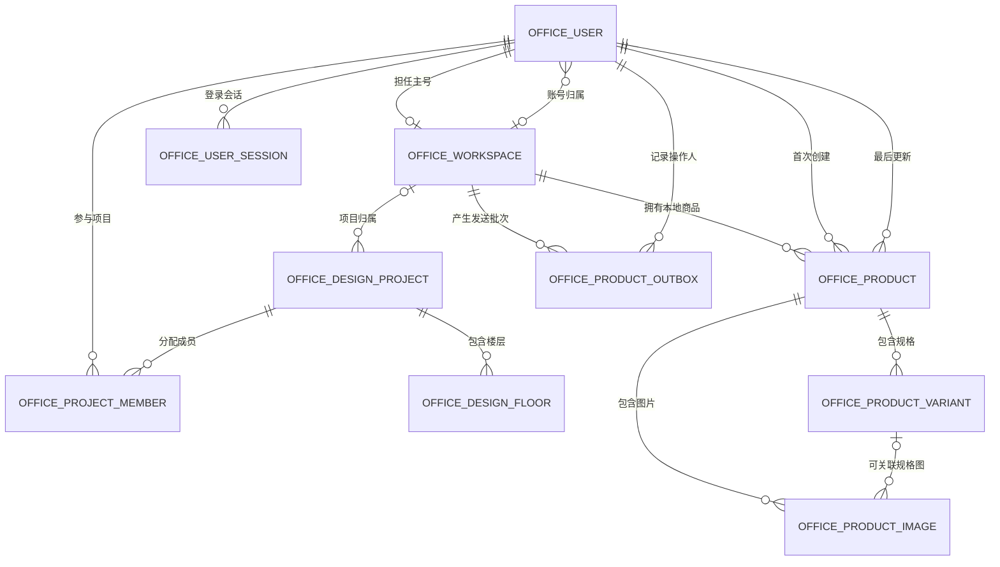

# Office 数据库账号与权限关系

核对日期：2026-11-24。本文对应当前工作区的代码与迁移，包含 Office 本地商品录入和 RSDP 审核接入。部署与验证进度见 [进度表](status.md)。

角色、主号名额和迁移规则见 [TENANT-004](tasks/TENANT-004-office-role-model.md)。

启动迁移默认初始化 23 张业务表。本机开发库另装空间模板表，2026-11-24 清理旧表后实测为 24 张。 [本机清理记录](tasks/DB-003-local-office-cleanup.md)

## 账号、工作区和项目

| 业务身份 | 数据库存放 | 实际权限范围 |
| --- | --- | --- |
| Office 系统管理员 | `office_user.is_system_admin = true`，部分唯一索引限制最多一人 | 可开设工作区及主号、修改工作区类型、管理已有账号状态和密码。 |
| 经销商主号、工厂主号 | `office_workspace.owner_user_id`，每个工作区一个主号 | 管理本区成员、项目权限和商品录入权限，可创建项目、操作本区报价和公共库开关。经销商与工厂工作区共用 20 个名额。 |
| 工作区成员 | `office_user.workspace_id` | 账号归属一个工作区。可查看本区本地商品，可访问主号授予项目查看权限的项目。 |
| 项目负责人、项目协作者 | `office_project_member.role`，操作权限放在同一行的 `permission_flags` | 可执行主号逐人勾选的操作。同一个人在不同项目可以拥有不同职责和权限。 |
| 商品录入权限 | `office_user.product_entry_enabled` | 主号可独立授予账户在本区保存商品、维护图片和导入 Excel 的权限。 |

`workspace_type` 取 `DEALER` 或 `FACTORY`。账号来源 `DEALER_STAFF` 和 `FACTORY_SALES` 用于展示。现有接口继续返回兼容的 `ADMIN/DEALER/USER` 账号标识，页面使用实际身份与工作区关系。 [角色与名额迁移](../backend/src/main/resources/db/migrations/20261124_simple_office_permissions.sql)、[工作区服务](../backend/src/main/java/com/rsdp/officeproduct/importer/office/service/OfficeWorkspaceService.java)

## 主要数据表关系

- **工作区**的 `owner_user_id` 是指向 `office_user` 的唯一外键。每个工作区有一位主号，每个主号最多拥有一个工作区。`office_user.workspace_id` 指向账号所在工作区，即使是主号也写入这项归属。 [工作区迁移](../backend/src/main/resources/db/migrations/20261106_workspace_roles.sql)
- **项目与楼层**以 `office_design_project.workspace_id` 记录项目归属，楼层通过 `office_design_floor.project_id` 继承项目的访问范围。账号和项目通过 `office_project_member(project_id, user_id)` 建立多对多关系。同一账号可在项目 A 任负责人，在项目 B 任协作者。项目负责人唯一索引保证至多一位，创建和替换成员的服务保证至少一位。未归属工作区的历史项目仍按项目成员关系判断。 [项目成员迁移](../backend/src/main/resources/db/migrations/20261029_project_members.sql)、[项目访问校验](../backend/src/main/java/com/rsdp/officeproduct/importer/office/service/OfficeProjectAccessService.java)
- **本地商品**以 `office_product.workspace_id` 记录归属。规格和图片使用包含工作区、商品 ID 的组合外键。商品保存记录 `created_by` 和 `updated_by`，发送批次还记录 `actor_id`。同工作区的授权录入员可修改本区其他成员录入的商品，录入人字段用于追踪操作。 [商品表迁移](../backend/src/main/resources/db/migrations/20261124_office_local_products.sql)、[本地商品服务](../backend/src/main/java/com/rsdp/officeproduct/importer/office/product/LocalProductService.java)
- **会话与审计**由 `office_user_session.user_id` 关联账号。认证开启时，后端按请求核验有效会话和账号状态。停用或重置密码会使现有会话失效。工作区创建、项目成员及授权变更、商品录入权限变更写入 `office_audit_log`。已被商品或发送批次引用的账号，受这些表的外键保护，硬删除会被数据库拒绝。 [认证服务](../backend/src/main/java/com/rsdp/officeproduct/importer/auth/AuthService.java)、[审计服务](../backend/src/main/java/com/rsdp/officeproduct/importer/office/service/OfficeAuditService.java)

## 商品权限和 RSDP 审核

1. **本地商品权限**以 Office 工作区为边界。主号和获授权工作区成员可以维护本区商品，其他本区成员可查看。即使录入员尚未加入任何项目，只要具备本区录入权，仍可处理本地商品。
2. **公共库开关**存于 `office_workspace.shared_catalog_enabled`，由主号控制，同一工作区成员跟随。关闭后，已配置本厂读取绑定的工作区仍可看到授权本厂主库目录，其余工作区在这一路径返回空目录。本地商品查询使用 Office 自有表。 [公共库服务](../backend/src/main/java/com/rsdp/officeproduct/importer/office/service/SharedCatalogService.java)、[主库读取绑定](../backend/src/main/java/com/rsdp/officeproduct/importer/office/service/OfficeCatalogAccess.java)
3. **跨系统提交**由 Office 后台读取 `office_product_outbox`，使用专用接入凭证推送已配置工作区的批次。RSDP 按工作区和供应厂绑定核验来源，再生成审核单。Office 人员使用自己的 Office 账号，提交记录保留实际录入人。 [自动投递与审核契约](tasks/INTEG-003-office-product-review.md#自动生成审核单)
4. **公共库审核**在 RSDP 执行。当前 RSDP 要求审核员拥有 `ADMIN` 或 `EDITOR`，并具有 `product:create` 权限。Office 的主号、系统管理员和商品录入员身份均独立于 RSDP 审核权限。正式主档及其变体由 RSDP 管理，整单处理满 7 天后只留精简结论与接收回执。 [审核权限和记录保留](tasks/INTEG-003-office-product-review.md#审核完成后七天清理)

## PostgreSQL 连接身份

Office 后端使用部署配置中的数据源账号连接 PostgreSQL，发布 Compose 使用 `SPRING_DATASOURCE_USERNAME` 对接 `POSTGRES_USER`。使用者身份存于 `office_user`，应用服务按会话和表关系执行业务授权。在所核对的 Office 迁移中，未为各类业务用户定义单独 PostgreSQL 登录角色或行级权限策略。 [部署配置](../compose.deploy.yaml)、[工作区迁移](../backend/src/main/resources/db/migrations/20261106_workspace_roles.sql)

例如，伟豪若配置为工厂工作区，伟豪主号与其员工账号通过同一个 `workspace_id` 归属。主号可给录入员开启 `product_entry_enabled`，录入员用 Office 账号保存商品。项目负责人由 `office_project_member` 独立分配。RSDP 审核员按 RSDP 权限审核伟豪上传批次。
