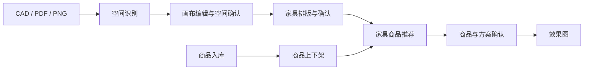

# 产品需求与验收基线 V1

更新日期：2026-10-13。来源：用户本轮明确的项目目标。
本文定义目标行为；实际实现和验证结果见 [进度表](status.md)。

## 1. 产品目标与业务顺序

商品资源独立维护：商品入库 → 编辑商品资料 → 随时上架/下架。

项目设计主流程：上传 CAD/PDF/PNG → 空间识别 → 导入无限画布 → 编辑、核对并确认全部设计空间 → 家具排版 → 确认排版 → 家具商品推荐 → 确认商品与方案 → 生成效果图。

商品库为推荐提供真实可用商品。空间识别产出的已有家具可作为参考，不直接等同于用户已确认的家具排版或已选商品。
用户可以返回前面的阶段修改；受影响的后续结果需要重新验证和确认。

## 2. 商品入库与上下架

本轮“入库”按商品资料录入商品库定义，可通过批量文件导入或手工录入。库存数量、仓储出入库与订单履约尚未在本轮明确，不作为本轮默认范围。

目标要求：

- 商品具有稳定 ID、名称、规格/变体、真实尺寸、价格及用于展示的资源；缺少关键字段要明确显示。
- 批量入库保留行级成功、失败、跳过和重复处理结果；预览与正式写入分开。
- 上架、下架可重复切换并持久保存；审核、上下架、删除是不同业务操作。
- 下架商品不进入新的推荐结果；后端与前端都核验可售状态。
- 已选方案引用的商品下架后，保留原位置与历史选择，标为待替换/待处理，不能静默删除家具。
- 确认方案时重新检查商品和具体变体状态、尺寸与价格，避免使用过时推荐。

验收：导入或手工录入一个商品后能查询到；下架后新的推荐不会出现；重新上架后可重新参与推荐；刷新后状态一致；审核操作不会被当成上下架操作。

## 3. CAD、PDF、PNG 空间识别

- CAD 支持 DWG/DXF；PDF 按选定页处理；PNG 支持平面图输入。其他现有图片格式可保留，但不得影响这三类主要路径。
- 文件、页/目标图、识别任务和识别结果分别有稳定标识，不能仅按文件名关联。
- 产出空间轮廓、空间名称/类型、尺寸、面积、单位与比例来源、识别质量和底图定位信息。
- 保留未命名空间和识别不足的信息，允许人工补充、修正或划定范围。
- CAD 文件单位未确定，以及 PDF/PNG 没有可靠尺寸参考时，允许先预览和编辑，实际尺寸标为待校准。
- PDF 页与 CAD 中的多个平面方案由用户选择目标，不能把不同页面或方案混为一个空间。
- 演示、估计和真实识别的来源必须清楚；识别置信度不等于用户已确认。

验收：三类文件分别有真实样本验证，能看到对应底图和空间；失败、部分识别、单位不明可明确反馈；未校准空间不会被用于精确家具排版。

## 4. 识别结果与无限画布对应

- 房间、墙体、门窗、底图及参考家具使用同一场景坐标基准；平移、缩放只改变视图。
- 从识别结果导入后保留每个空间的来源和原始多边形，不能用包围盒替代异形房间真实轮廓。
- 未命名空间仍可选中、命名和编辑；明确区分建筑房间与其中划定的办公功能分区。
- 支持整体视图和单空间视图，切换视图不改变几何、空间 ID 或家具归属。
- 画布支持连续平移/缩放、选择、编辑、排版、撤销/重做与草稿保存；固定显示区域不构成业务几何边界。
- 上传结果重新识别或替换时，保留此前编辑稿，明确比较/替换范围，避免清空用户已编辑内容。

验收：矩形、L 形/凹多边形、多房间场景分别核对；房间位置、比例、方向、面积和底图一致；缩放、切换视图及刷新后仍一致。

## 5. 空间编辑与数值联动

- 用户可以拖动边界、修改顶点、调整房间大小，也可以手工创建空间。
- 用户输入实际宽度/进深后，设计空间几何和画布形状随之变化；拖动修改后，尺寸和面积同步反映新几何。
- 实际尺寸编辑使用米或毫米等明确单位，产品操作不要求用户理解 px。
- “校准图纸比例”与“修改某房间尺寸”分开：前者改变物理尺寸解释，后者修改设计几何。
- 原始识别几何保留，编辑发生在设计副本；底图可用于对照，不伪装成随房间编辑而修改的原始图纸。
- 异形空间不将包围盒宽深乘积作为净面积；孔洞、柱和禁放区域参与几何检查。
- 空间编辑冲突、非法轮廓和邻接边界问题明确反馈，未解决前不能确认相关空间。
- 所有纳入当前方案的空间分别确认后，才进入家具排版；不设计的区域显式标为排除，不用删除来假装已完整识别。

验收示例：矩形会议室从 6m × 4m 修改为 8m × 4m，在固定视图比例下宽度由对应的 6m 增至 8m，面积由 24㎡ 变为 32㎡；缩放视图不改变上述实际尺寸；撤销、重做和刷新后结果正确。
L 形空间修改尺寸后仍保留 L 形结构，面积由修改后的多边形计算。

## 6. 家具排版先于商品推荐

- 排版阶段使用家具类型、占地宽深、高度（需要时）、数量、旋转、间距和位置等需求，可先使用未绑定商品的布局单元。
- 支持人工摆放、拖动、旋转、参数排版和撤销/重做；每件家具归属于稳定的空间 ID。
- 家具尺寸、间距和位置以实际空间几何计算；检查异形边界、家具相交、门口与通行区域。
- 排版不会自行伸缩家具以挤入空间，也不会把放不下的数量默认为已成功放置。
- 先确认排版版本，再推荐可匹配布局需求的商品和变体。
- 商品真实尺寸与布局预留不匹配时提出替换或调整建议，用户修改排版后重新确认，不能静默改变排版。

验收：没有选定商品时也可完成排版；家具不越界、不相交，数量与布局实例一致；未确认排版不能进入正式商品推荐。

## 7. 家具推荐、方案确认与效果图

- 推荐输入来自已确认的空间、排版需求及预算/风格等用户信息。
- 推荐只使用当前上架且满足既有审核要求的商品/变体，说明尺寸匹配与未满足条件。
- 选择商品后建立“布局单元 → 商品 → 变体”的明确映射，保留需求与实际商品规格。
- 方案确认前核对空间版本、排版版本、商品状态、数量、尺寸和价格。
- 效果图基于已确认方案快照，记录空间/布局/商品版本、视角与结果来源。
- 修改空间、排版或已选商品后，旧效果图保留为历史版本并标为需重新生成，不自动代表最新方案。
- 效果图中空间、家具数量、位置、朝向及选定款式应与方案对应；若生成能力只能表达风格概念，必须标为概念图，不作为精确方案验收结果。
- 生成服务支持等待、失败、重试和历史查看；重复请求避免产生重复任务。

验收：有确认的方案才能提交生成；返回的图像关联到正确方案与任务；生成过程中修改方案不会把旧结果标为新版本。

## 8. 阶段约束与变更影响

以下为目标业务状态，尚未完整实现。界面、后端和恢复后的草稿使用同一约束。

| 阶段 | 进入下一阶段前应具备的条件 |
| --- | --- |
| 识别/草稿 | 文件目标已选择，有可编辑空间或人工创建入口 |
| 空间确认 | 纳入方案的空间全部确认，单位可靠，几何问题已解决或有明确人工处理记录 |
| 排版确认 | 布局满足当前空间约束，用户确认布局版本 |
| 商品确认 | 推荐与当前布局版本一致，商品/变体仍可用，匹配问题已处理 |
| 方案确认 | 各空间、布局和商品选择形成一致快照 |
| 效果图 | 仅对该已确认快照生成和展示当前结果 |

空间几何变化：取消受影响空间的确认，相关排版和商品匹配标为待核验；全局比例变化影响所有空间。
排版变化：重新确认排版并核验推荐/已选商品；商品变化：重新核验尺寸匹配与方案。
仅修改视图缩放/平移不取消业务确认；仅修改便签不自动推断几何变化。
未受影响的空间保留确认记录，但整体方案必须重新汇总受影响部分后才能再次确认。

## 9. 当前范围的边界

当前目标包含商品管理、空间识别与编辑、家具排版、推荐和效果图完整流程。
仓储库存、采购支付、施工图出图、多人实时协同等未在本轮明确，不默认扩大本轮需求。
几何容差、通道间距、数值编辑交互细节和效果图服务选型由对应开发任务记录；文档中的目标不作为现有实现已经通过验收的证明。
