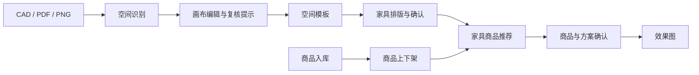

# 产品需求与验收基线 V1

更新日期：2026-10-17。来源：用户明确的项目目标及首期契约优化。
本文定义目标行为；实际实现和验证结果见 [进度表](status.md)。

## 1. 产品目标与业务顺序

商品资源独立维护：商品入库 → 编辑商品资料 → 随时上架/下架。

项目设计主流程：上传 CAD/PDF/PNG → 空间识别 → 导入无限画布 → 按需编辑空间（系统提示复核，无需逐个确认） → 生成可复用空间模板 → 家具排版 → 确认排版 → 家具商品推荐 → 确认商品与方案 → 生成效果图。

商品库为推荐提供真实可用商品。空间识别产出的已有家具可作为参考，不直接等同于用户已确认的家具排版或已选商品。
用户可以返回前面的阶段修改；受影响的后续结果需要重新验证和确认。

2026-10-17 用户要求移除全局“项目信息”（名称、建筑面积、人数、预算、整体偏好、说明），上传和设计不再依赖填写或创建项目资料。既有 projectId 仅作设计数据隔离键；标题使用图纸文件名。单次效果预览的风格选择保留，空间面积仍从几何计算。具体实现与删表迁移见 [WORKSPACE-001](tasks/WORKSPACE-001-remove-project-info.md)。

## 2. 商品入库与上下架

本轮“入库”按商品资料录入商品库定义，可通过批量文件导入或手工录入。库存数量、仓储出入库与订单履约尚未在本轮明确，不作为本轮默认范围。

目标要求：

- 商品具有稳定 ID、名称、规格/变体、真实尺寸、价格及用于展示的资源；缺少关键字段要明确显示。
- 批量入库保留行级成功、失败、跳过和重复处理结果；预览与正式写入分开。
- 上架、下架可重复切换并持久保存；审核、上下架、删除是不同业务操作。
- 下架商品不进入新的推荐结果；后端与前端都核验可售状态。
- 已选方案引用的商品下架后，保留原位置与历史选择，标为待替换/待处理，不能静默删除家具。
- 确认方案时重新检查商品和具体变体状态、尺寸与价格，避免使用过时推荐。

验收：导入或手工录入一个商品后能查询到；下架后新的推荐不会出现；重新上架后可重新参与推荐；刷新后状态一致；审核操作不会被当成上下架操作。

## 3. CAD、PDF、PNG 空间识别

- CAD 支持 DWG/DXF；PDF 按选定页处理；PNG 支持平面图输入。其他现有图片格式可保留，但不得影响这三类主要路径。
- 当前工作区一次只上传一张图纸；文件选择和拖放统一限制单文件，多文件整体拒绝并提示。再次上传替换当前文件，清除上传页旧识别预览，已有画布编辑和历史识别保留；PDF 仍按选定页识别。
- 文件、页/目标图、识别任务和识别结果分别有稳定标识，不能仅按文件名关联。
- 产出空间轮廓、空间名称/类型、尺寸、面积、单位与比例来源、识别质量和底图定位信息。
- 保留未命名空间和识别不足的信息，允许人工补充、修正或划定范围。
- CAD 文件单位未确定，以及 PDF/PNG 没有可靠尺寸参考时，允许先预览和编辑，实际尺寸标为待校准。
- PDF/PNG 优先自动读取尺寸标注、对应尺寸线和明确单位，交叉校验比例，再由用户确认应用。无单位需显示假设并允许修改；参考不足或冲突保留人工校准，不静默换算毫米或代替空间确认。
- PDF 页与 CAD 中的多个平面方案由用户选择目标，不能把不同页面或方案混为一个空间。
- 演示、估计和真实识别的来源必须清楚；识别置信度不等于用户已确认。

验收：三类文件分别有真实样本验证，能看到对应底图和空间；失败、部分识别、单位不明可明确反馈；未校准空间不会被用于精确家具排版。

## 4. 识别结果与无限画布对应

- 房间、墙体、门窗、底图及参考家具使用同一场景坐标基准；平移、缩放只改变视图。
- 从识别结果导入后保留每个空间的来源和原始多边形，不能用包围盒替代异形房间真实轮廓。
- 未命名空间仍可选中、命名和编辑；明确区分建筑房间与其中划定的办公功能分区。
- 支持整体视图和单空间视图；单空间设计仅展示当前空间轮廓、归属家具和局部内容，整层底图与其他空间留在总览。切换视图不改变几何、空间 ID 或家具归属。
- 画布支持连续平移/缩放、选择、编辑、排版、撤销/重做与草稿保存；固定显示区域不构成业务几何边界。
- 上传结果重新识别或替换时，保留此前编辑稿，明确比较/替换范围，避免清空用户已编辑内容。

验收：矩形、L 形/凹多边形、多房间场景分别核对；房间位置、比例、方向、面积和底图一致；缩放、切换视图及刷新后仍一致。

## 5. 空间编辑与数值联动

- 用户可以拖动边界、修改顶点、调整房间大小，也可以手工创建空间。
- 选中轮廓后可直接拖动内部平移、拉边调整宽深、拉角放大缩小，并支持锁定比例；编辑轮廓可推拉单边、拖动顶点和补转折点。几何调整更新实际尺寸与面积，滚轮等视图缩放不改变几何，支持取消和撤销。
- 用户输入实际宽度/进深后，设计空间几何和画布形状随之变化；拖动修改后，尺寸和面积同步反映新几何。
- 实际尺寸编辑使用米或毫米等明确单位，产品操作不要求用户理解 px。
- “校准图纸比例”与“修改某房间尺寸”分开：前者改变物理尺寸解释，后者修改设计几何。
- 原始识别几何保留，编辑发生在设计副本；底图可用于对照，不伪装成随房间编辑而修改的原始图纸。
- 异形空间不将包围盒宽深乘积作为净面积；孔洞、柱和禁放区域参与几何检查。
- 建筑房间轮廓沿墙内侧；墙厚间隔不判裂缝。净地面面积扣孔洞/永久实心障碍且不重复扣除，禁放区域影响排版可用区域，不自动扣净面积。
- 系统对识别候选、重叠或边界疑点提示“需复核”，由用户按需修改；复核提示不拦截进入家具排版，不要求逐个或全部确认空间，也不自动伪造人工确认。
- 未知比例、缺失/自交/退化等无法计算的轮廓与无效空间 ID 仍明确反馈并阻止精确排版；图纸比例确认和后续排版确认保留。
- 不设计的区域可显式排除，不用删除来假装已完整识别。识别失败或无候选时可基于已处理页面创建空稿人工描绘，保留失败记录和人工来源。

验收示例：矩形会议室从 6m × 4m 修改为 8m × 4m，在固定视图比例下宽度由对应的 6m 增至 8m，面积由 24㎡ 变为 32㎡；缩放视图不改变上述实际尺寸；撤销、重做和刷新后结果正确。
L 形空间修改尺寸后仍保留 L 形结构，面积由修改后的多边形计算。

## 5.1 空间模板

- 空间编辑完成后可生成整层空间模板，以彩色分区图展示实际多边形、名称和面积，保留空间相对位置、毫米单位、来源版本及复核提示。
- 模板为独立快照，可保存到项目、重新读取和用于后续排版；更新空间不改写旧模板，提示需要重新生成。模板不含当前家具或商品选择。
- 使用模板产生独立的布局副本，已有草稿可撤销恢复；不增加逐空间确认门槛，也不把生成模板当作已人工测量/核验。
- 未知比例/非法几何不能生成精确模板，未识别的门窗、墙和障碍层仍标未知，不伪造完整建筑数据。
- 直接进入排版可先捕获本地模板；显式保存成功后才显示远端已保存，可跨会话读取。后续布局记录模板与空间引用。

## 6. 家具排版先于商品推荐

- 排版阶段使用家具类型、占地宽深、高度（需要时）、数量、旋转、间距和位置等需求，可先使用未绑定商品的布局单元。单位模块全部复用手动布局中的可见办公家具目录、毫米规格和参数化图例，模块卡片与画布线稿一致。
- 用户可新增自己的单位模块：填写名称、复用家具图例、指定毫米宽深/可选高度，保存后复用；可以选择模块逐件点击放到空间中，连续添加、旋转或结束，已有家具保留。自定义目录与已摆实例分开，修改目录不能静默改变旧家具。
- 主按钮“一键自动排版”固定自动比较横纵方向，按房间宽深生成多排，不受恢复的旧单排选择限制；单排等方式通过“应用单排方案”等独立入口执行。分开显示当前已放置和当前方式预估，位置/图例/尺寸不同也提示方案尚未应用；显示自动方案件数与排数，允许编辑排间净距、离墙距离和同排间距。参数预估不静默替换现有家具，点击应用后才生成新布局并反馈实际件数。
- 新建单位模块布局的同排/列间距默认 0 mm，可选择左右留缝并输入毫米数；保留旧方案已保存的间距。提供面对面、错位排、中间通道等常用方式，组内中缝和中央通道宽度可调整。
- 面对面/背靠背按坐席方向定义：面对面坐席相对，背靠背坐席朝外；中间通道必须形成独立的左右桌列和连续中央净空，不能仅复用矩阵的上下行布局。
- 支持人工摆放、拖动、旋转、参数排版和撤销/重做；每件家具归属于稳定的空间 ID。选中画布家具可用明确按钮或 Delete/Backspace 删除，支持撤销并使该空间剩余家具的排版确认失效；输入和弹窗操作不得误删画布。自定义目录删除独立于实例删除，保留旧实例快照，并提供最近一次目录删除的恢复入口。
- 单空间内可用 Shift/Ctrl/Command 点选或拖框选择多件家具，整组拖动保持相对位置，批量删除可一次撤销；越界或与组外家具相交时整组不提交。多选不改变其他空间家具，单选仍可编辑属性。
- 家具尺寸、间距和位置以实际空间几何计算；检查异形边界、家具相交、门口与通行区域。
- 排版不会自行伸缩家具以挤入空间，也不会把放不下的数量默认为已成功放置。
- 先确认排版版本，再推荐可匹配布局需求的商品和变体。
- 商品宽、深分别不超过已确认模块预留时向下兼容，可选择旋转 90°；按较低轴占比分为贴合/宽松/偏小，档位不排除更小规格。推荐显示真实变体毫米尺寸、剩余空间及缺尺寸提示；同规格模块可批量选择，保留预留几何与实际商品尺寸各自独立。高度和用途另行核对。
- 商品真实尺寸与布局预留不匹配时提出替换或调整建议，用户修改排版后重新确认，不能静默改变排版。

验收：没有选定商品时也可完成排版；家具不越界、不相交，数量与布局实例一致；未确认排版不能进入正式商品推荐。

## 7. 家具推荐、方案确认与效果图

2026-10-15 用户补充：单空间排版后可先生成带三维视觉效果的二维图片，优先使用 Qwen-Image-3.0。
此辅助入口标为“概念效果预览”，不要求先选商品或确认正式方案，不改变正式方案流程；记录不可变布局快照并在布局变化后标记历史，图像对应性仍需核对。具体边界见 [生图配置](render-configuration.md)。

- 推荐输入来自当前空间几何、已确认的排版需求及预算/风格等用户信息。
- 推荐只使用当前上架且满足既有审核要求的商品/变体，说明尺寸匹配与未满足条件。
- 选择商品后建立“布局单元 → 商品 → 变体”的明确映射，保留需求与实际商品规格。
- 方案确认前核对空间版本、排版版本、商品状态、数量、尺寸和价格。
- 效果图基于已确认方案快照，记录空间/布局/商品版本、视角与结果来源。
- 修改空间、排版或已选商品后，旧效果图保留为历史版本并标为需重新生成，不自动代表最新方案。
- 效果图中空间、家具数量、位置、朝向及选定款式应与方案对应；若生成能力只能表达风格概念，必须标为概念图，不作为精确方案验收结果。
- 生成服务支持等待、失败、重试和历史查看；重复请求避免产生重复任务。

验收：有确认的方案才能提交生成；返回的图像关联到正确方案与任务；生成过程中修改方案不会把旧结果标为新版本。

## 8. 阶段约束与变更影响

以下为目标业务状态，尚未完整实现。界面、后端和恢复后的草稿使用同一约束。

| 阶段 | 进入下一阶段前应具备的条件 |
| --- | --- |
| 识别/草稿 | 文件目标已选择，有可编辑空间或人工创建入口 |
| 空间编辑 | 单位可靠且有可计算轮廓；识别疑点仅提示复核，不要求逐个确认空间 |
| 排版确认 | 布局满足当前空间约束，用户确认布局版本 |
| 商品确认 | 推荐与当前布局版本一致，商品/变体仍可用，匹配问题已处理 |
| 方案确认 | 各空间、布局和商品选择形成一致快照 |
| 效果图 | 仅对该已确认快照生成和展示当前结果 |

空间几何变化：更新几何与复核提示，旧人工确认记录失效，相关排版和商品匹配标为待核验；全局比例变化影响所有空间，不增加逐个确认步骤。
排版变化：重新确认排版并核验推荐/已选商品；商品变化：重新核验尺寸匹配与方案。
仅修改视图缩放/平移不取消业务确认；仅修改便签不自动推断几何变化。
未受影响的空间保留确认记录，但整体方案必须重新汇总受影响部分后才能再次确认。

## 9. 当前范围的边界

用户进一步明确的首期重点：PDF/PNG 平面空间识别、准确对应无限画布、用户手动修正及尺寸/面积联动、撤销/重做、保存恢复与复核提示。
未知比例可先预览和修正轮廓，完成校准后才能进入精确排版；PDF 支持页预览和选择，首期不默认跨页拼接。
首期任务拆分不降低空间编辑和保存的优先级；具体契约与验收见 [Spatial 实施方案](../Spatial_Canvas_Engine_前后端开发实施方案_V1.0.md)。
先贯通单房间修改/保存/刷新/进入排版/再修改失效，同期验证真实识别，再扩展复杂编辑；自动识别原始质量与人工修正后正确性按 [样本附件](spatial/recognition-validation.md) 分别验收。

当前目标包含商品管理、空间识别与编辑、家具排版、推荐和效果图完整流程。
仓储库存、采购支付、施工图出图、多人实时协同等未在本轮明确，不默认扩大本轮需求。
几何容差、通道间距、数值编辑交互细节和效果图服务选型由对应开发任务记录；文档中的目标不作为现有实现已经通过验收的证明。
